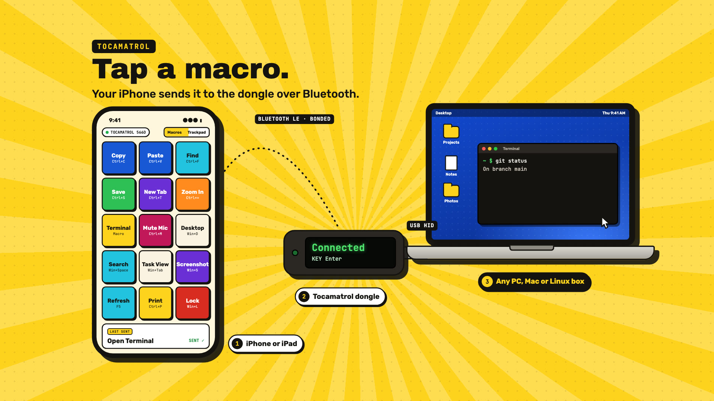

# Tocamatrol

Tocamatrol turns your iPhone or iPad into a customizable macro pad and wireless trackpad for
any PC, Mac, or Linux machine—with **no drivers or software to install** on the computer.

[](https://ryancummings.github.io/tocamatrol/media/tocamatrol-how-it-works.mp4)

<sub>▶ Click the image to watch the 14-second demo. The source is in [`tools/promo_video/`](tools/promo_video).</sub>

```
iPhone / iPad app ──BLE (bonded, encrypted)──▶ ESP32-S3 USB dongle ──USB HID mouse + keyboard──▶ PC / Mac / Linux
```

## Features

- **Magic Trackpad mode**: 1-finger pointer with smooth acceleration, tap-to-click,
  tap-then-drag, 2-finger tap right-click, 3-finger tap/drag middle-click, palm rejection,
  and 2-finger vertical + horizontal scrolling with momentum coasting and Natural/Classic toggle.
- **Customizable Macro Pad**: Create multiple pages with configurable grid dimensions,
  resizable multi-cell buttons (`1×1`, `2×1`, `3×1`, `2×2`, or any span), drag-to-arrange
  layout editing, custom colors/typefaces/captions, step-by-step macro editor (text,
  shortcuts, pauses, virtual PC keyboard recording), playback speeds, and JSON library
  import/export.
- **Zero software on the computer**: The ESP32-S3 dongle enumerates as a standard USB HID
  mouse and keyboard using built-in OS drivers.
- **Browser Web Flasher**: Flash supported ESP32-S3 boards right from Chrome, Edge, or Brave
  using the built-in Web Serial flasher—no IDE or toolchain required.
- **Privacy & security**: Only bonded devices can send input ([ADR 0002](docs/adr/0002-bonded-phones-only.md)),
  release firmware exposes only HID interfaces ([ADR 0003](docs/adr/0003-hid-only-release-build.md)),
  and macros stay encrypted on-device with optional Face ID / passcode lock.

## Repository layout

| Path | What |
| --- | --- |
| [`protocol/PROTOCOL.md`](protocol/PROTOCOL.md) | BLE packet spec. Single source of truth. |
| [`boards.json`](boards.json) | Supported ESP32-S3 hardware definitions shared by CI and the web flasher. |
| [`dongle/`](dongle) | ESP32-S3 firmware (PlatformIO, Arduino, NimBLE-Arduino, TinyUSB HID). |
| [`ios/`](ios) | SwiftUI iOS/iPadOS app (iOS 17+), XcodeGen project, `TocaCore` Swift package. |
| [`web/`](web) | Static web flasher (`esptool-js`), compatible hardware guide, and pairing docs. |
| [`tools/`](tools) | Python BLE test sender (`send_test.py`), Linux HID event watcher (`watch_hid.py`), and the how-it-works promo video and App Store art source (`promo_video/`). |
| [`GLOSSARY.md`](GLOSSARY.md), [`docs/adr/`](docs/adr) | Domain terms and architecture decision records. |

## Compatible Hardware (ESP32-S3 only)

Your dongle **must** use an **ESP32-S3** chip because Tocamatrol requires both Bluetooth LE
and native USB-OTG HID on the same microcontroller:

| Chip | Works? | Why |
| --- | --- | --- |
| **ESP32-S3** | **Yes** | Has both BLE 5 and native USB-OTG HID |
| ESP32 (classic) | No | No native USB-OTG port |
| ESP32-S2 | No | Has USB-OTG, but **no Bluetooth** |
| ESP32-C3 / ESP32-C6 | No | Has BLE, but **no native USB-OTG** (USB-Serial/JTAG only) |

Supported boards (configured in [`boards.json`](boards.json) and [`dongle/include/board_config.h`](dongle/include/board_config.h)):

| Board | Env | Status Indicator | Notes |
| --- | --- | --- | --- |
| **LilyGO T-Dongle-S3** *(recommended)* | `t-dongle-s3` | 0.96" LCD + dim back LED | Direct USB-A plug, pocket-sized dongle |
| **Seeed Studio XIAO ESP32-S3** | `xiao-esp32s3` | Single user LED | Ultra-compact USB-C |
| **ESP32-S3-DevKitC-1 (N8 / N4)** | `devkitc-s3-n8` | WS2812 RGB LED | Dual USB-C: flash via `COM`, plug `USB` into PC |
| **ESP32-S3-DevKitC-1 (N16R8 / N8R8 Octal PSRAM)** | `devkitc-s3` | WS2812 RGB LED | Dual USB-C: flash via `COM`, plug `USB` into PC |

## Flashing the Dongle

### Option 1: Browser Web Flasher (easiest)

Open the Tocamatrol Web Flasher in Chrome, Edge, or Brave on macOS, Windows, or Linux,
select your board, hold **BOOT** while plugging it in (not needed when flashing DevKitC-1 via
its `COM` port), and click **Flash Firmware**.

### Option 2: Build and flash from source (PlatformIO)

```sh
uv tool install platformio          # once
cd dongle
pio test -e native                  # host-side logic tests, no board needed
pio run                             # builds release binaries + merged 0x0 images
pio run -e t-dongle-s3 -t upload    # hold BOOT while plugging in first
```

Release builds expose **only USB HID** (no USB serial port), so re-flashing via native USB
always requires holding **BOOT** while plugging the dongle in, followed by unplugging and
replugging normally (or pressing **RST**).

## Pairing & Connecting

1. Plug the flashed dongle into your computer (on dual-USB DevKitC-1 boards, use the port
   labeled **USB**).
2. The dongle opens a **60-second pairing window** at power-up (or whenever you press **BOOT**
   briefly). The status screen shows **Pair now** (amber fast blink on LED-only boards).
3. Open **Tocamatrol** on your iPhone or iPad, tap the **Dongle** chip in the top bar, and
   tap **Pair** next to your dongle (`Tocamatrol XXXX`).
4. Accept the iOS **Bluetooth Pairing Request**. The dongle shows **Connected** (steady green).
5. Bonded phones reconnect automatically without pressing the dongle button. To erase all
   stored bonds on the dongle, hold **BOOT** for **5 seconds**, and also forget the dongle in
   **iOS Settings → Bluetooth**.

## Building the iOS App

Requires a Mac with Xcode 16+, iOS 17+ device for Bluetooth testing, and [XcodeGen](https://github.com/yonaskey/XcodeGen):

```sh
brew install xcodegen
cd ios
cp LocalSigning.xcconfig.example LocalSigning.xcconfig   # set your Apple Team ID
xcodegen generate
open Tocamatrol.xcodeproj
```

Run pure Swift unit tests on macOS or Linux:

```sh
cd ios/TocaCore && swift test
```

## Testing without a Phone

```sh
uv run tools/send_test.py --selftest    # verify packet encoding matches PROTOCOL.md
uv run tools/send_test.py               # send pointer, click, drag, scroll, and split tests
uv run tools/send_test.py keys          # type "Tocamatrol" and Ctrl+C
```

On Linux, inspect raw USB HID events emitted by the dongle:

```sh
sudo uv run tools/watch_hid.py
```

## License

[MIT](LICENSE)
